<p align="center"></p>

<p align="center"><b>La motion capture avec deux téléphones ou plus.</b><br>
Corps et doigts, sans marqueurs sur l'acteur, jusqu'à votre personnage 3D.</p>

---

## Ce que fait MOCAM

Vous filmez un acteur avec deux téléphones ou plus, posés sur trépied. MOCAM en tire une animation 3D
complète (corps, mains et doigts) et la livre en **FBX**, prête pour Blender, Unity, Unreal ou
3ds Max.

MOCAM, c'est trois choses :

| | |
|---|---|
| **L'app MOCAM** (iPhone et Android) | Transforme chaque téléphone en caméra pilotée par le PC. |
| **MOCAM Studio** (PC Windows) | Connecte les téléphones, lance l'enregistrement, traite les prises et montre le résultat en 3D sur votre personnage. Capture aussi le visage (52 blendshapes ARKit) avec une seule caméra. |
| **L'add-on Blender** et **le script 3ds Max** | Transfèrent l'animation sur vos propres personnages, dans vos logiciels. |

Ce que vous obtenez pour chaque prise :
* `prise_XXX_ybot.fbx` : l'animation sur **Y Bot** (ou sur votre personnage), maillage compris ;
* `prise_XXX.fbx` : le **squelette seul**, au format Mixamo (65 os), aux proportions et à la
  taille réelles de l'acteur.

## Sommaire

1. [Ce qu'il vous faut](#1-ce-quil-vous-faut)
2. [Installation](#2-installation)
3. [Préparer la pièce](#3-préparer-la-pièce)
4. [Tutoriel : MOCAM Studio pas à pas](#4-tutoriel--mocam-studio-pas-à-pas)
5. [Capture du visage](#5-capture-du-visage)
6. [Utiliser l'animation](#6-utiliser-lanimation)
7. [Dépannage](#7-dépannage)

---

## 1. Ce qu'il vous faut

* **Un PC Windows** avec Python 3.11 ou 3.12 et **Blender** (gratuit, blender.org).
* **Deux téléphones ou plus**, récents (testé avec un iPhone 12 Pro et un Poco X3 NFC), un trépied par téléphone.
* **Cinq demi-boules** de couleur vive et mate : 2 rouges, 1 verte, 1 bleue, 1 jaune.
* Un réseau commun : le Wi-Fi de la maison, ou le partage de connexion d'un téléphone.

## 2. Installation

### Sur le PC (une fois)

1. Installez **Python 3.11 ou 3.12** depuis python.org, en cochant *Add python.exe to PATH*.
2. Installez **Blender**.
3. Double-cliquez sur **`installer.bat`** dans le dossier de MOCAM. Il installe tout le
   nécessaire. Au premier traitement, les modèles de détection (environ 200 Mo) se téléchargent
   tout seuls.

Pour lancer le logiciel ensuite : double-clic sur **`MOCAM Studio.bat`**.

### Sur les téléphones (une fois)

L'app est compilée gratuitement par GitHub, à chaque modification du dossier `mobile\`.
Sur la page du dépôt, onglet **Actions**, ouvrez le dernier lancement *App mobile MOCAM*,
puis téléchargez en bas de page, rubrique **Artifacts** :

* **Android** : `MOCAM-android`. Copiez `MOCAM.apk` sur le téléphone, ouvrez-le et acceptez
  l'installation depuis une source inconnue.
* **iPhone** : `MOCAM-iphone`. Installez-le avec **Sideloadly** (sideloadly.io) et un Apple ID
  gratuit :
  1. installez iTunes et iCloud **depuis le site d'Apple** (pas ceux du Microsoft Store) ;
  2. branchez l'iPhone, touchez *Se fier à cet ordinateur* ;
  3. dans Sideloadly, glissez `MOCAM-non-signee.ipa`, entrez votre Apple ID, cliquez **Start** ;
  4. sur l'iPhone, activez *Réglages > Confidentialité et sécurité > Mode développeur*, puis
     *Réglages > Général > VPN et gestion de l'appareil* > votre Apple ID > **Faire confiance**.

  Avec un Apple ID gratuit, l'app doit être réinstallée **tous les 7 jours** (même fichier,
  même étape 3). Rien n'est perdu.

### Dans Blender (facultatif)

*Édition > Préférences > Modules complémentaires > ▾ > Installer depuis le disque*, choisissez
`blender_addon\mocapcam_blender.py`, puis cochez **MOCAM**.

## 3. Préparer la pièce

### Les boules au sol

Les boules servent à placer les caméras dans l'espace. Collez-les au sol (adhésif double face)
en **carré**, de 1,5 à 3 m de côté selon la pièce, plus une boule au milieu d'un côté :

```
   D jaune ─────────────── C bleue
     │                        │
     │                        │
   E rouge    (zone de jeu)   │
     │                        │
     │                        │
   A rouge ─────────────── B verte
```

* Seule **la forme** compte : quatre côtés égaux et **deux diagonales égales** (vérifiez au
  mètre ruban). E doit être pile au milieu de A-D. 2 à 3 cm d'erreur, c'est bon.
* Pas besoin de mesurer le côté : **l'échelle vient de la taille de l'acteur**, que vous
  indiquez dans Studio.
* Chaque caméra doit voir au moins 4 boules, idéalement les 5. Une boule cachée par l'acteur
  pendant la prise n'est pas un problème.
* Aucune autre calibration : la position des caméras est recalculée à chaque prise, vous pouvez
  déplacer les trépieds d'une séance à l'autre.

### Les caméras

* Trépieds à **1,2–1,5 m** de haut, à **3–4 m** du centre de la zone.
* Avec deux téléphones : **devant l'acteur**, écartés de **70 à 90°**. Avec plus de
  téléphones, répartissez-les en arc autour de la zone : chaque caméra en plus réduit les
  membres cachés.
* Tout le corps dans le cadre, **bras levés compris**, et les boules visibles.
* Gardez les **mains tournées vers les caméras** : une main cachée derrière
  le corps ne peut pas être reconstruite.

Il n'y a rien à régler sur les téléphones : l'app impose elle-même 60 images/s, coupe la
stabilisation et le HDR, et bloque l'exposition à la demande.

---

## 4. Tutoriel : MOCAM Studio pas à pas

Studio a trois onglets : **Tournage** pour filmer, **Prises** pour traiter et regarder le
résultat, **Personnages** pour vos modèles 3D. La roue dentée, en haut à droite, ouvre les
réglages.

### Étape 1 : connecter les téléphones

Lancez **`MOCAM Studio.bat`**. Une fenêtre noire s'ouvre (le serveur : laissez-la ouverte),
puis l'interface.

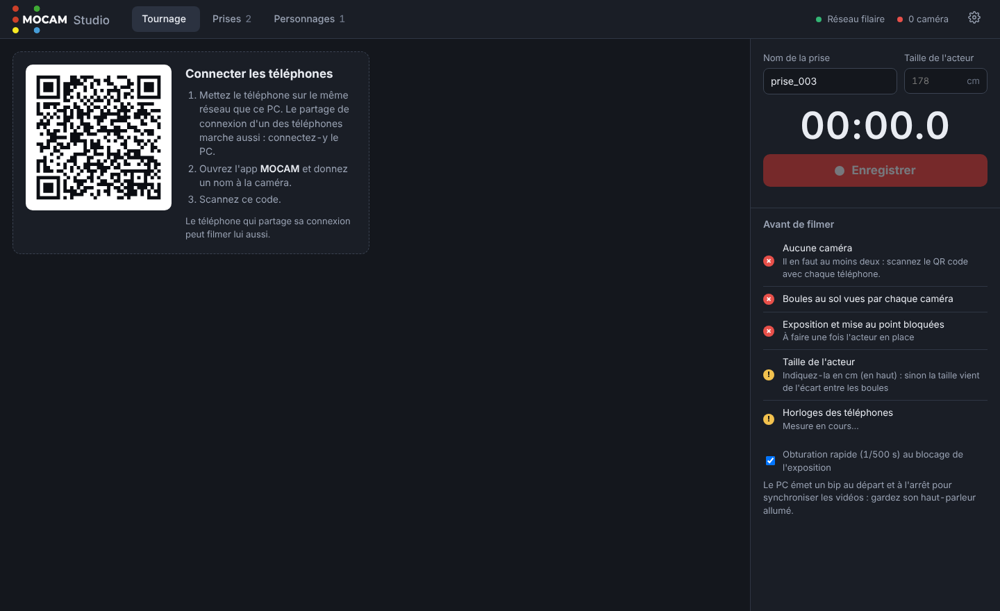

1. Mettez le PC et les téléphones **sur le même réseau** : votre Wi-Fi, ou le partage de
   connexion d'un des téléphones (celui-ci peut filmer lui aussi). Le point d'accès mobile du PC
   marche aussi.
2. Sur chaque téléphone, ouvrez l'app **MOCAM**, donnez un nom à la caméra (`iphone`, `poco`…)
   et **scannez le QR code**. C'est le seul moyen de connexion : aucune adresse à taper.
3. La prochaine fois, *Reprendre la dernière connexion* dans l'app évite de rescanner.

> Si Windows classe le réseau comme « public » (fréquent avec un partage de connexion), Studio
> affiche un bouton **Autoriser MOCAM** : il ouvre le pare-feu pour MOCAM seulement.

### Étape 2 : régler et vérifier les caméras

Dès qu'un téléphone est connecté, sa carte apparaît avec l'image en direct.

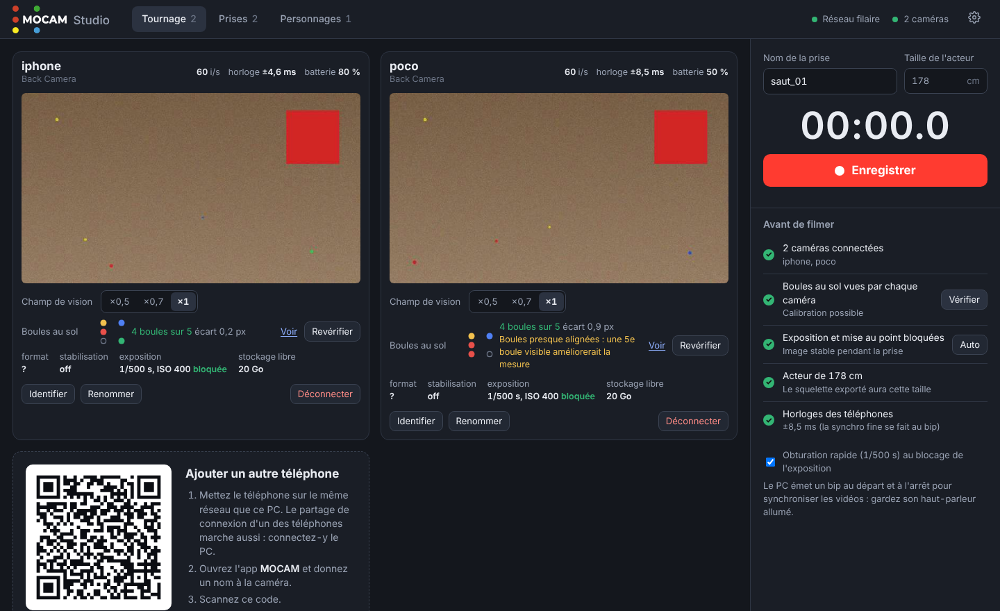

Sur chaque carte :

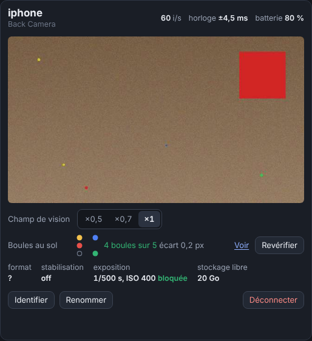

* **Champ de vision** : **×1** (objectif principal, le plus précis) ou plus large, jusqu'à
  l'ultra grand-angle (**×0,5**). Élargissez dans une petite pièce ou si l'acteur sort du cadre.
  Le réglage se fait aussi depuis l'app, et chaque téléphone le retient.
* **Boules au sol** : cliquez **Vérifier**. Le petit carré de 5 points montre les boules vues,
  *Voir* ouvre l'image de contrôle. Il en faut au moins 4.
* **Identifier** affiche le nom de la caméra en grand sur le téléphone, pratique pour savoir
  lequel est lequel.
* En haut : images par seconde, écart d'horloge et batterie.

### Étape 3 : nommer la prise et indiquer la taille de l'acteur

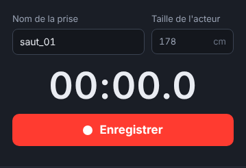

* **Nom de la prise** : proposé tout seul (`prise_001`, `prise_002`…), modifiable.
* **Taille de l'acteur**, en **cm**, comme il jouera (pieds nus ou chaussé). L'animation
  exportée fera exactement cette taille, pieds au sol.

### Étape 4 : la liste « Avant de filmer »

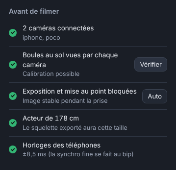

Tout doit être au vert :
* les **caméras** connectées ;
* les **boules** vues par chaque caméra (bouton **Vérifier** pour toutes d'un coup) ;
* l'**exposition bloquée** : placez l'acteur et la lumière, puis cliquez **Bloquer** (**Auto**
  la débloque). L'option *obturation rapide* réduit le flou des mains ;
* la **taille de l'acteur** ;
* les **horloges** des téléphones (mesurées toutes seules).

### Étape 5 : enregistrer

Cliquez **● Enregistrer**. Tous les téléphones démarrent ensemble, puis le PC émet un **bip**
qui les synchronise à la milliseconde : gardez le son du PC allumé. Pas besoin de clap.

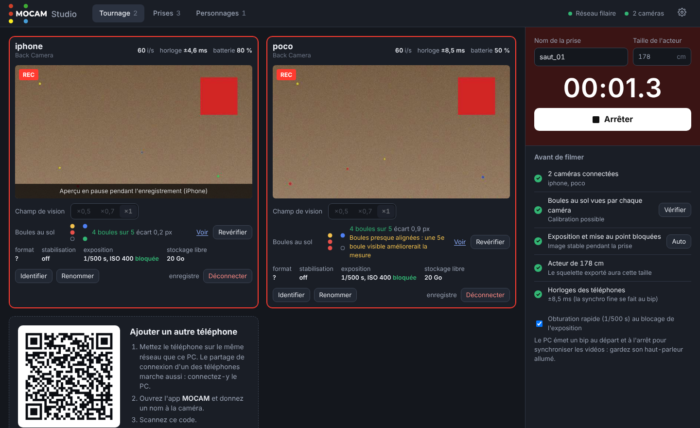

Jouez l'action : commencez par **2 secondes en T-pose**, et si l'action est statique, ajoutez
une dizaine de secondes de marche dans toute la zone (cela aide à affiner les caméras). Puis
**■ Arrêter**. Les vidéos arrivent toutes seules sur le PC.

### Étape 6 : traiter la prise

Onglet **Prises** : choisissez la prise, puis **Traiter la prise**.

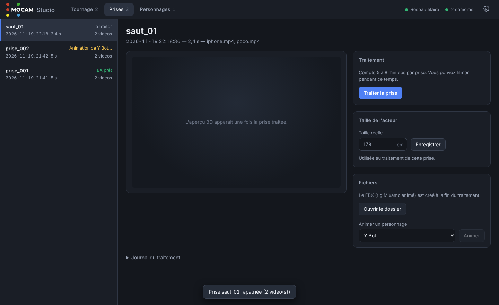

Comptez **5 à 8 minutes** par prise. Les 6 étapes s'affichent avec leur avancement. Vous
pouvez filmer d'autres prises pendant ce temps : elles attendent leur tour.

### Étape 7 : regarder le résultat

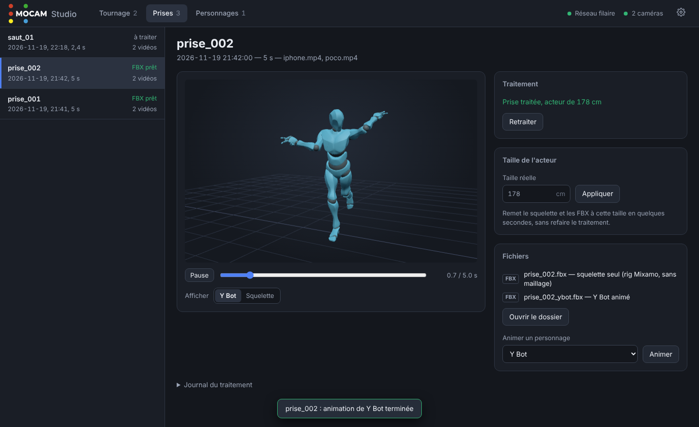

* L'**aperçu 3D** montre l'animation sur **Y Bot** (ou sur vos personnages animés, bouton
  *Afficher*). Lecture, pause, et image par image avec le curseur. Tournez autour à la souris.
* **Taille de l'acteur** : une erreur ? Tapez la bonne taille, puis **Appliquer**. C'est
  immédiat, sans retraiter : les FBX sont refaits.
* **Fichiers** : les FBX produits, et **Ouvrir le dossier** pour les récupérer
  (`captures\nom_de_la_prise\`).
* **Animer un personnage** : appliquer la prise à un autre de vos personnages.
* **Supprimer la prise** (en haut à droite) : son dossier part à la corbeille de Windows, vous
  pouvez le récupérer.

### Étape 8 : utiliser votre propre personnage

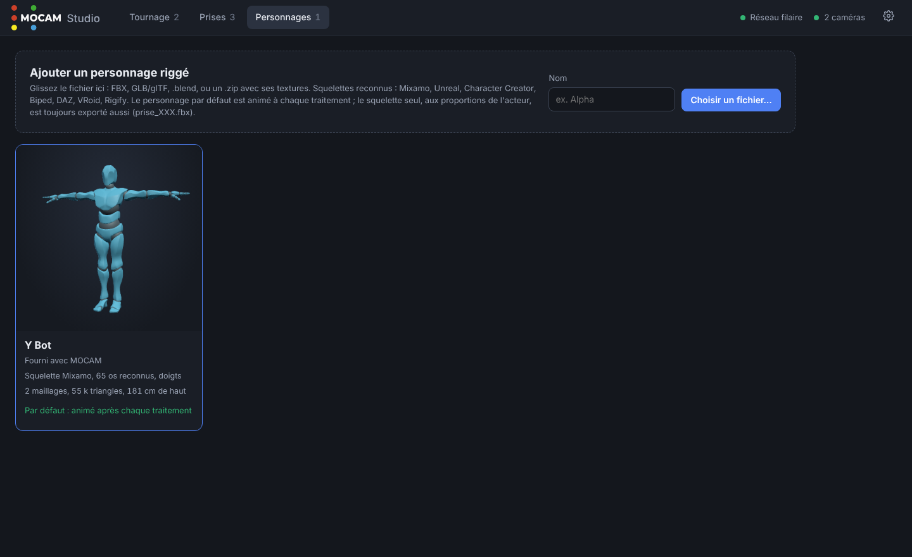

Par défaut, chaque prise est animée sur **Y Bot**, le personnage Mixamo fourni. Pour animer
le vôtre :

1. Onglet **Personnages** : donnez un nom, puis glissez le fichier de votre personnage riggé
   (**FBX, GLB/glTF, .blend**, ou un **.zip** avec ses textures).
2. Studio l'analyse et affiche sa vignette et le squelette reconnu : **Mixamo, Unreal,
   Character Creator, Biped, VRoid, DAZ, Rigify**, ou des noms d'os courants. Les doigts sont
   animés s'il en a.
3. **Utiliser par défaut** : il remplace Y Bot, et chaque nouvelle prise est animée dessus.
   Pour les prises déjà traitées : onglet *Prises* > *Animer un personnage* > **Animer**.

Le personnage garde son maillage, ses matériaux et ses proportions : seule l'animation est
ajoutée.

> Y Bot est installé depuis le dossier `personnages_fournis\`. Il n'est pas publié sur GitHub
> (Mixamo interdit de redistribuer ses fichiers tels quels) : le fichier `LISEZMOI.txt` de ce
> dossier explique comment le retélécharger.

### Les réglages

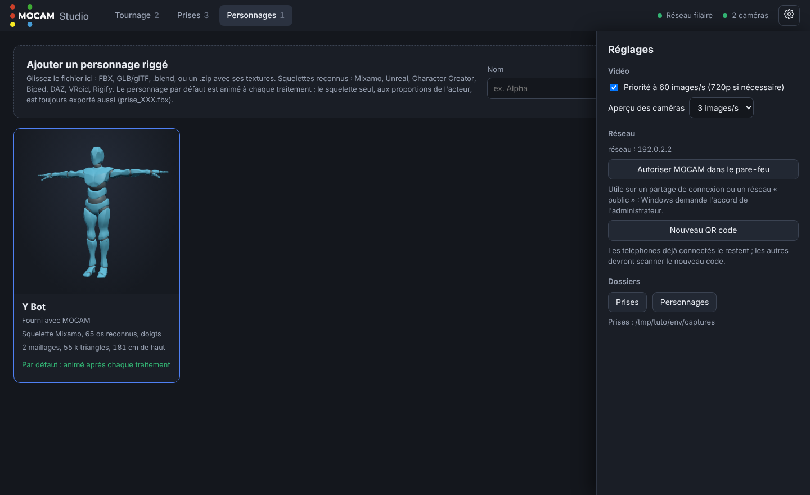

* **Priorité à 60 images/s** : si un téléphone n'y arrive pas en 1080p, il passe en 720p.
* **Aperçu des caméras** : cadence des images en direct (à baisser si le Wi-Fi est faible).
* **Réseau** : les adresses du PC, le bouton pare-feu, et **Nouveau QR code** : les téléphones
  déjà connectés le restent, les autres devront scanner le nouveau code.
* **Dossiers** : ouvrir le dossier des prises et celui des personnages.

---

## 5. Capture du visage

L'onglet **Visage** enregistre les expressions du visage avec **une seule caméra** et les
exporte en **52 blendshapes ARKit** (le standard d'Apple, reconnu par Unreal, Unity, Blender,
Character Creator, MetaHuman…), plus la rotation de la tête.

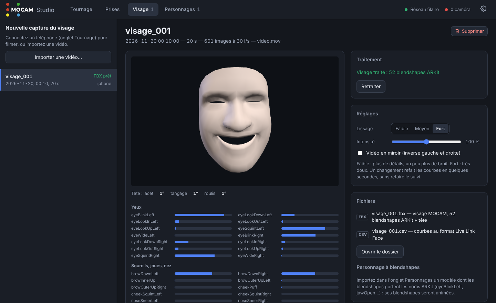

**Filmer** : dans *Nouvelle capture du visage*, choisissez le téléphone, cliquez **Avant** pour
passer sur sa caméra avant (vous vous voyez pendant la prise), puis **Enregistrer le visage**
et **Arrêter**. Ou cliquez **Importer une vidéo…** (ou glissez-la sur l'onglet) : n'importe
quelle vidéo de visage, filmée avec l'appareil photo du téléphone par exemple.

Pour la meilleure qualité :
* le visage **de face**, à 40–70 cm, et qui remplit bien l'image ;
* une lumière **douce et de face** (pas de contre-jour, pas d'ombre forte d'un côté) ;
* rien devant la bouche ou les yeux ; des lunettes réduisent la précision du regard ;
* gardez **quelques secondes de visage neutre** dans la prise (au début, par exemple) : MOCAM
  s'en sert pour régler le repos de chaque expression.

**Traiter** : c'est automatique dès que la vidéo arrive (moins d'une minute pour 20 s de vidéo).
MOCAM suit 478 points du visage image par image, mesure les paupières pour des clignements
nets, ramène chaque expression au repos à 0, puis lisse les courbes sans retard (les sourcils
plus fort, les paupières et la mâchoire moins, pour garder les mouvements rapides).

**Vérifier** : la vidéo et le visage 3D sont synchronisés, les barres montrent chaque
blendshape à l'instant affiché. Les **Réglages** s'appliquent en quelques secondes sans
refaire le suivi :
* *Lissage* : faible (plus de détails), moyen, fort (très doux) ;
* *Intensité* : de 50 à 150 %, pour adoucir ou accentuer toutes les expressions ;
* *Vidéo en miroir* : à cocher si la vidéo est inversée comme dans un miroir (gauche et
  droite échangées).

**Les fichiers** (dans `visages\visage_XXX\`) :

| Fichier | Contenu |
|---|---|
| `visage_XXX.fbx` | un visage animé avec ses 52 blendshapes ARKit et un os de tête |
| `visage_XXX.csv` | les courbes au format **Live Link Face** (Epic Games) : import direct dans Unreal ou les add-ons Blender qui lisent ce format |
| `visage_XXX_<personnage>.fbx` | votre personnage, ses blendshapes animées |

**Sur votre personnage** : importez-le dans l'onglet *Personnages* ; il doit avoir des
blendshapes aux noms ARKit (`eyeBlinkLeft`, `jawOpen`… ; les variantes `EyeBlink_L` ou
`A25_Jaw_Open` de Character Creator sont reconnues). Une tête seule, sans squelette, est
acceptée. Dans l'onglet *Visage*, choisissez-le dans *Personnage à blendshapes* et cliquez
**Animer**, ou cochez *Animer ce personnage après chaque capture*. Si son squelette a un os de
tête, il tourne aussi.

## 6. Utiliser l'animation

### Les fichiers

Dans `captures\prise_XXX\` :

| Fichier | Contenu |
|---|---|
| `prise_XXX_ybot.fbx` | Y Bot (ou votre personnage) animé, maillage compris |
| `prise_XXX.fbx` | le squelette seul : 65 os Mixamo, proportions de l'acteur, corps et doigts, 60 images/s, pose de repos en T-pose |

Le squelette seul est l'équivalent d'une animation Mixamo téléchargée « sans skin ». Tout outil
qui accepte les animations Mixamo sait l'utiliser.

### Unity et Unreal

* **Unity** : importez le FBX, *Rig > Animation Type : Humanoid*. Les noms Mixamo sont reconnus
  tout seuls ; l'animation s'applique ensuite à n'importe quel humanoïde.
* **Unreal** : importez le FBX, puis reciblez avec l'IK Retargeter (préréglage Mixamo).

### Blender, avec l'add-on MOCAM

Barre latérale (touche **N**) > onglet **MOCAM** :

1. **Importer une animation (.fbx)** : choisissez `prise_XXX.fbx`. La cadence et la plage
   d'images de la scène sont réglées toutes seules.
2. Choisissez la **Cible** (l'armature de votre personnage), puis **Retarget**. Préfixes
   Mixamo, échelle, T-pose ou A-pose : tout est géré.
3. **Exporter en FBX** pour récupérer le personnage animé.

Si la scène passe à 30 images/s (cela arrive en important un personnage Mixamo), l'animation
paraît au ralenti : le panneau l'affiche en rouge, avec un bouton pour corriger.

### 3ds Max, sur un Biped

1. Importez `prise_XXX.fbx` dans 3ds Max, avec votre Biped dans la scène.
2. Glissez `3dsmax\MocapCam_Biped.ms` dans une fenêtre 3ds Max.
3. Choisissez un os du squelette Mixamo, puis le Biped, et cliquez **Transférer l'animation**.

Le Biped garde sa morphologie ; effacez ses pas avant le transfert.

---

## 7. Dépannage

| Problème | Solution |
|---|---|
| Studio s'ouvre vide ou dit « doit être relancé » | Un ancien Studio tourne encore. Relancez `MOCAM Studio.bat` : il prend sa place tout seul. |
| Le téléphone ne trouve pas le PC | Même réseau (pas un Wi-Fi « invité »). Sur un partage de connexion, cliquez **Autoriser MOCAM**. Si le PC a changé de réseau, rescannez le QR code. |
| Boules introuvables | Regardez l'image de contrôle (*Voir*) : moins de 4 boules, boules trop petites, lumière trop faible, ou carré déformé. |
| Personnage trop grand ou trop petit | Onglet *Prises* > *Taille de l'acteur* > **Appliquer**. |
| L'app ne propose que ×1 | Ce téléphone réserve son ultra grand-angle à sa propre app photo : reculez la caméra. |
| Bip « peu audible » | Montez le volume du PC. Sinon, la synchro se fait par les horloges, un peu moins précise. |
| Doigts qui tremblent | Rapprochez les caméras et éclairez mieux. |
| Un bras ou une jambe qui « saute » | Le membre était caché pour une caméra : orientez l'action face aux caméras, ou ajoutez un 3ᵉ téléphone. |
| Personnage refusé | Il faut un squelette humanoïde (bassin, colonne, cou, tête, bras, jambes). Studio indique les os qu'il n'a pas reconnus. |
| « Blender introuvable » | Installez Blender depuis blender.org. |
| Visage : « aucun visage trouvé » | Cadrez le visage de face, plus près, avec plus de lumière. |
| Visage : gauche et droite inversées | Cochez *Vidéo en miroir* dans les réglages du visage. |
| L'app iPhone ne s'ouvre plus | Les 7 jours sont passés : réinstallez-la avec Sideloadly. |

---

<sub>Pour les développeurs : le code de l'app est dans `mobile\MocapCamPhone` (Expo,
VisionCamera), le dialogue PC ↔ téléphones est décrit dans `mobile\MocapCamPhone\PROTOCOLE.md`,
et les tests sont dans `tests\` (`test_synthetique.py`, `test_studio.py`, `test_visage.py`).
La capture du visage utilise MediaPipe Face Landmarker de Google (licence Apache 2.0), installé
et téléchargé automatiquement au premier usage.</sub>
